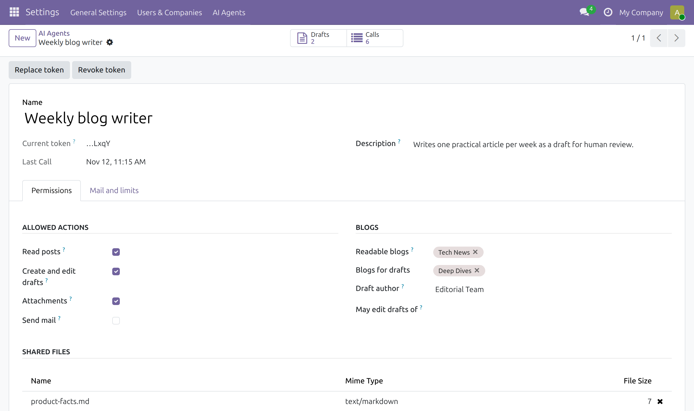
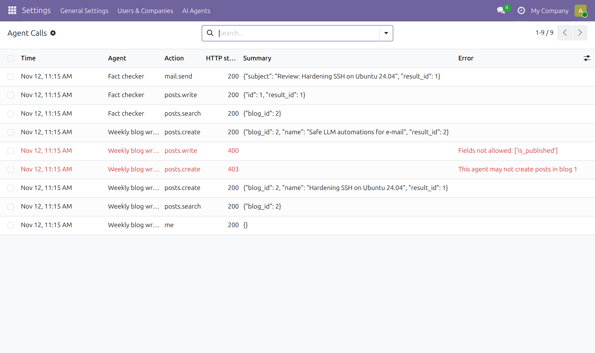
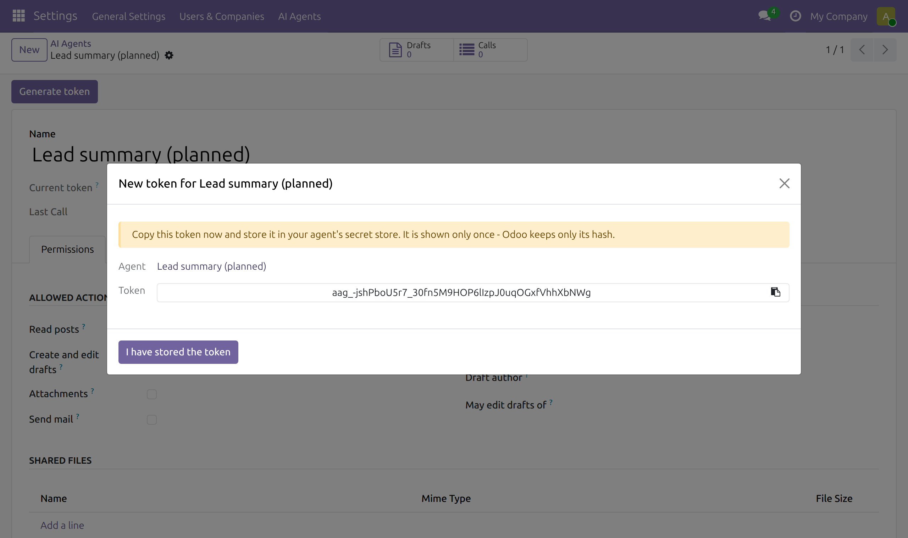

# Odoo AI Agent Gateway

**Let AI agents work in Odoo – without giving them an API key.**

AI agents (Claude, ChatGPT, n8n workflows, custom scripts …) usually connect to Odoo with a full API key.
That key carries every right of the user behind it: the agent could publish, delete, read customer data or
change accounting – whatever the prompt, a bug or a prompt injection tells it to do.

`ai_agent_gateway` puts a narrow door in front of Odoo instead. Each agent gets **its own token** and a
**small HTTP API with a fixed list of actions**. The agent prepares the work; **a human publishes it.**

```
AI agent ──Bearer token──▶ /ai-agent-gateway/v1/<action> ──▶ checks ──▶ Odoo (blog drafts, files, mail)
                                       │
                                       └─ token hash · capabilities · scope · rate limit · call log
```

[](https://github.com/jz-webservices/odoo-ai-agent-gateway/actions/workflows/tests.yml)

- Odoo **19.0**, Community or Enterprise – depends only on `website_blog` and `mail`
- License: **LGPL-3.0** (like Odoo Community)

---

## Screenshots

**One record per agent** – capabilities, blogs, shared files, token:



**Every call is logged** – rejected calls in red:



**Tokens are shown once** – Odoo stores only the hash:



## What an agent can do – and nothing more

| Capability (tick per agent) | Actions | Scope |
|---|---|---|
| – | `me` | the agent's own permissions, for setup checks |
| Read posts | `tags`, `posts.search` | `posts.search`: only the blogs you select, only whitelisted fields; `tags`: all blog tags (names only) |
| Create and edit drafts | `posts.create`, `posts.write` | new posts are **always unpublished**; an agent edits **only its own** drafts – or those of agents you explicitly allow, e.g. a reviewer – and only until they are published |
| Attachments | `attachments.list`, `attachments.read`, `attachments.create` | JPEG/PNG/WebP images and private HTML backups on its own drafts, plus files you explicitly share with it |
| Send mail | `mail.send` | to **one fixed recipient** set in Odoo, with a limit per 24 hours |

Everything else – publishing, deleting, other models, other blogs, other agents' drafts – does not exist
for the agent.

## Security model

| Threat | What the gateway does |
|---|---|
| Leaked token | Token is tied to one agent with minimal rights. Only its SHA-256 hash is stored; replace or revoke it with one click. Archiving the agent also blocks it. |
| Agent "decides" to publish or delete | There is no action for it. Only whitelisted fields are accepted; anything else (`is_published`, `author_id`, `website_id`, `active`, …) is rejected with HTTP 400. |
| Agent edits human content | Agents can only change drafts created by an agent (themselves, or agents listed under *May edit drafts of*), and only while unpublished. |
| Prompt injection → XSS in a post | HTML is sanitized with Odoo's `html_sanitize` (scripts, event handlers, `javascript:` links, inline styles removed). Cover settings are validated against a whitelist. |
| Malicious uploads | Only JPEG, PNG, WebP and HTML are accepted; images are checked against their file signature (for WebP only the RIFF header), max. 8 MB, safe file names. HTML files are never public. |
| Mail abuse | Recipient and sender are fixed in Odoo – the agent cannot set them. Mail limit per agent and 24 hours. |
| Runaway loop | Sliding requests-per-hour limit per agent (HTTP 429); all logged calls of the agent count towards it. |
| Token guessing | Tokens carry 256 bits of randomness. Invalid tokens are logged as warnings with the client IP (suitable for fail2ban), but are not rate-limited by the module. |
| "What did the agent do?" | Every authenticated call that reaches an action – accepted or rejected – is logged with action, HTTP status, IDs, post title or mail subject, error message and IP address. Post bodies, mail bodies and file contents are never logged. Logs are deleted after 90 days (system parameter `ai_agent_gateway.log_retention_days`). |

### What the gateway does not protect

- Actions run with `sudo()`: Odoo access rights and record rules do not apply – the module's own checks are
  the only barrier. Keep the list of actions small.
- A readable blog exposes all its posts to the agent, including unpublished drafts written by humans.
- An agent can overwrite human edits on drafts it may edit, as long as they are unpublished.
- Images uploaded with `public: true` are reachable by URL before the post is published.
- A new token stays in the transient wizard record until you click **I have stored the token** or Odoo
  vacuums transient records; closing the dialog with × leaves it there until then.
- The logged IP is the proxy's address unless Odoo runs with `--proxy-mode`.

The gateway does not replace your normal Odoo hardening (HTTPS, reverse proxy, backups, updates). It removes
the need to hand an AI agent a full API key.

## Quick start

1. Copy `ai_agent_gateway` into your addons path and install it.
2. **Settings → AI Agents → Agents → New**
   - tick the capabilities the agent needs,
   - choose the blogs it may read and write drafts to,
   - optionally: draft author, shared files, mail sender/recipient, limits.
3. Click **Generate token** and store the token in the agent's secret store. It is shown only once.
4. Check the setup:

```bash
curl -s https://<your-odoo>/ai-agent-gateway/v1/me \
  -H "Authorization: Bearer $AGENT_TOKEN" \
  -H "Content-Type: application/json" -d '{}'
```

```json
{"result": {
  "name": "Weekly blog writer",
  "actions": ["attachments.create", "attachments.list", "attachments.read",
              "me", "posts.create", "posts.search", "posts.write", "tags"],
  "readable_blogs": [{"id": 1, "name": "Tech News"}, {"id": 2, "name": "Deep Dives"}],
  "draft_blogs": [{"id": 2, "name": "Deep Dives"}],
  "may_edit_drafts_of": [],
  "shared_files": [{"id": 283, "name": "style-guide.md"}, {"id": 284, "name": "product-facts.md"}],
  "mails_left_today": 0
}}
```

If your server hosts several databases, add the header `X-Odoo-Database: <db name>`.

## API

`POST /ai-agent-gateway/v1/<action>` with a JSON object as body and `Authorization: Bearer <token>`.
Responses are `{"result": …}` (HTTP 200) or `{"error": "…"}` with 400, 401, 403, 404, 429 or 503;
unexpected server errors return Odoo's standard 500 response.

| Action | Body | Result |
|---|---|---|
| `me` | `{}` | name, allowed actions, blogs, agents whose drafts it may edit, shared files, mails left |
| `tags` | `{}` | `{"tags": [{"id", "name"}]}` |
| `posts.search` | `blog_id`, optional `published`, `name_like` (SQL `LIKE` pattern), `created_after` (`YYYY-MM-DD HH:MM:SS` UTC), `fields`, `order` (`create_date desc` / `post_date desc`), `limit` (1–30) | `{"posts": [...]}` |
| `posts.create` | `blog_id`, `name`, `content` (HTML), optional `subtitle`, `tag_ids`, `website_meta_title`, `website_meta_description`, `cover_properties` | `{"id", "website_url", "is_published": false}` |
| `posts.write` | `id`, `vals` (same fields as create, without `blog_id`) | `{"id", "written", "is_published"}` |
| `attachments.list` | `post_id` (own draft) | `{"attachments": [...]}` |
| `attachments.read` | `id` (shared file or attachment of an own draft) | `{"id", "name", "mimetype", "datas"}` (base64) |
| `attachments.create` | `post_id`, `name`, `mimetype`, `datas` (base64), optional `public` | `{"id", "name", "public"}` |
| `mail.send` | `subject`, `body_html` | `{"id", "state", "to"}` |

Readable post fields: `id`, `name`, `subtitle`, `content`, `website_url`, `website_meta_title`,
`website_meta_description`, `tag_ids`, `blog_id`, `create_date`, `post_date`, `is_published`, `ai_agent_id`.

## Using it from an agent

### Python (standard library only)

```python
import json, os, urllib.error, urllib.request

def gateway(action, payload=None):
    req = urllib.request.Request(
        f"{os.environ['ODOO_URL']}/ai-agent-gateway/v1/{action}",
        data=json.dumps(payload or {}).encode(),
        headers={"Content-Type": "application/json",
                 "Authorization": f"Bearer {os.environ['AGENT_TOKEN']}"},
        method="POST")
    try:
        return json.load(urllib.request.urlopen(req, timeout=60))["result"]
    except urllib.error.HTTPError as e:   # 4xx/5xx: the JSON error is in the body
        raise RuntimeError(f"{action}: HTTP {e.code} {e.read().decode()[:500]}") from None

draft = gateway("posts.create", {
    "blog_id": 2,
    "name": "Hardening SSH on Ubuntu 24.04",
    "content": "<p>…</p>",
})
print("Draft for review:", draft["website_url"])
```

### n8n

Use an **HTTP Request** node: method `POST`, URL `https://<your-odoo>/ai-agent-gateway/v1/posts.create`,
authentication *Generic → Header Auth* with name `Authorization` and value `Bearer <token>`, body type JSON.
Put an LLM node in front of it to produce the `name` and `content` fields.

### LLM agents (Claude, ChatGPT, …)

Give the agent the API table above, the blog id(s) and the rule *"you create drafts, a human publishes"*.
Provide the token as an environment variable or secret – never inside the prompt. A useful pattern is two
agents with two tokens:

1. **Writer** – `posts.search` (avoid duplicates) → `posts.create` → `attachments.create` (images).
2. **Reviewer** (with *May edit drafts of: Writer*) – reads the newest draft, checks facts and links, stores the original as a private HTML
   backup, corrects the draft with `posts.write` and sends one summary with `mail.send`.

The editor reads the mail, opens the draft and publishes it – or not.

## Running the tests

```bash
docker network create aag-test
docker run -d --name aag-db --network aag-test \
  -e POSTGRES_USER=odoo -e POSTGRES_PASSWORD=odoo -e POSTGRES_DB=postgres postgres:16
docker run --rm --network aag-test -e HOST=aag-db -e USER=odoo -e PASSWORD=odoo \
  -v "$PWD":/mnt/extra-addons:ro odoo:19.0 \
  odoo -d aag_test -i ai_agent_gateway --test-enable --test-tags /ai_agent_gateway --stop-after-init
docker rm -f aag-db && docker network rm aag-test
```

## Roadmap

- More scopes beyond the blog: e.g. creating CRM leads or project tasks as drafts for human review
- Per-agent IP allow list
- Optional approval queue for mails

Ideas and pull requests are welcome.

## Support and custom work

This project is maintained by [JZ Webservices](https://www.jzwebservices.com) (Austria) – Odoo development,
Linux administration and AI automation for small and medium businesses.

- **Community support:** GitHub issues, best effort, no guarantee.
- **Setup, custom actions and AI agent workflows for your Odoo:** [contact us](https://www.jzwebservices.com/contactus).

## License

[LGPL-3.0](LICENSE) (see also [COPYING](COPYING) for the GPL-3.0 text it builds on). © 2026 JZ Webservices.
This software is provided without warranty; see the license for details.
